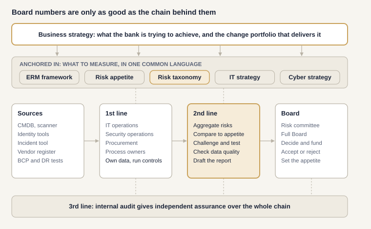
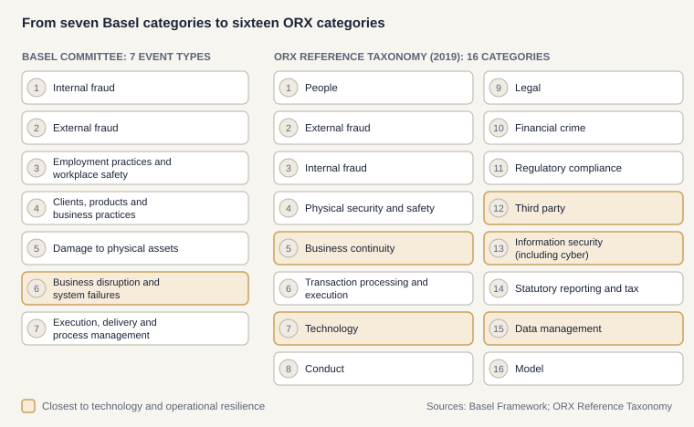

# 02. The reporting chain: behind the one-page Board report

**Newsletter:** Edition 2, *Behind the Page: How the Numbers Get There*.

A Board report on operational resilience and ICT risk is only as good as the chain behind it: who owns each number, which system it comes from, how it is checked, and which framework says what "green" means. This folder gives you the templates to build that chain.

*Read it top to bottom, then left to right: the business strategy sets the direction, the anchors decide what is measured and in which language, data flows from source systems through the first and second lines to the Board, and internal audit assures the whole chain.*

## Use it in 30 minutes

1. **Score yourself.** Open `reporting-chain-toolkit.xlsx`, sheet *7 Readiness*. Score the 18 statements from 0 to 3. The sheet calculates your step averages and an overall level.
2. **Follow one number home.** Pick one indicator from your last Board report. Trace it on sheet *5 Lineage trace*: every hand it passes through, every manual step, every check.
3. **Write its contract.** Fill one row on sheet *4 Data contracts*: definition, calculation, source, owner, checks, thresholds. The last column tells you if anything essential is missing.
4. **Agree who does what.** Walk through sheet *3 Who does what* with the first-line owners and internal audit.

Light yellow cells are inputs. Every sheet starts with a filled example for the fictional Bank Horizon.

## What is inside

| File | What it is for |
| --- | --- |
| `reporting-chain-toolkit.xlsx` | The workbook: all seven templates, with dropdowns and checks |
| `1-anchors-checklist.csv` | Ten questions: business strategy, ERM, appetite, taxonomy, IT and cyber strategy |
| `2-risk-taxonomy-starter.csv` | Sixteen level-1 risk categories with plain-language meanings, owners and Basel mapping |
| `3a-who-does-what.csv` | First, second and third line, and the Board, for each block of the Board page |
| `3b-raci-reporting-chain.csv` | RACI for the ten activities of the reporting chain |
| `4-kri-data-contracts.csv` | Data contracts for ten sample key risk indicators |
| `5-data-lineage-trace.csv` | A worked lineage trace for one indicator |
| `6-operating-models.csv` | How the approach changes with outsourcing, size and group structure |
| `7-readiness-assessment.csv` | The 18 readiness statements, to score |
| `six-steps.md` | The six steps to get there, with what good looks like |
| `follow-one-number.md` | How supervisors test the chain, and how to test it yourself first |
| `` | The reporting chain and the Basel and ORX taxonomies, as SVG |

## The risk taxonomy: the glue

When incidents, risk assessments, indicators, audit findings and the Board report all use the same risk categories, numbers from different teams can be added up. The starter taxonomy uses the sixteen ORX reference category names, with our own plain-language meanings, mapped to the seven Basel event types for benchmarking.

## Regulatory anchors

- **CBUAE Operational Risk Management Regulation (2026):** Board reporting that is comprehensive, accurate, consistent and actionable; integration of operational, ICT and cyber risk into the risk framework; the process universe with process and risk owners; the three lines of defence.
- **Basel Committee, BCBS 239 (2013):** principles for effective risk data aggregation and risk reporting.
- **DORA (EU) 2022/2554:** management body responsibility and ICT risk reporting, as the European reference.

*References are indicative. Map against the official texts before relying on them.*

## Further reading

- Elena Pykhova, *Operational Risk Management in Financial Services* (Kogan Page, 2nd edition, 2024), chapter 1 on definitions and taxonomy.
- ORX Reference Taxonomy (2019).
