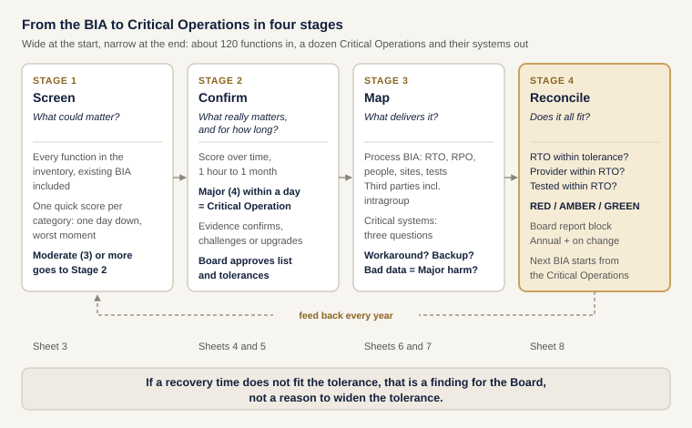

# 04. From the BIA to Critical Operations

Companion to *The Resilience Bridge*, Edition 4: **Follow the Money**.

Most banks already have a business impact analysis (BIA). This folder shows how to use it as the starting point for Critical Operations, test it against the money and the customer harm, find the systems that really matter, and check that every recovery time fits inside the tolerance the Board approved.

## The approach in four stages

| Stage | Question | What you do | What you get | Sheet |
| --- | --- | --- | --- | --- |
| **1. Screen** | What could matter? | Every function in the inventory, the existing BIA included, gets one quick score per impact category: *if it stopped for a day at the worst moment, how bad?* | A short list for Stage 2. Moderate (3) or more goes on; everything else is reviewed annually | 3 |
| **2. Confirm** | What really matters, and for how long? | Score each candidate over time, from 1 hour to 1 month. Then check the scores against hard evidence: customers affected, income at risk, market or licence impact | Critical Operations and a draft tolerance for each, confirmed, challenged or upgraded by the evidence, and approved by the Board | 4, 5 |
| **3. Map** | What delivers it? | Break each Critical Operation into processes (RTO, RPO, people, third parties, tests). Run each system through a three-question decision tree | The process BIA and a list of critical systems, each with a reason | 6, 7 |
| **4. Reconcile** | Does it all fit? | Compare every recovery time, provider and test with the tolerance | RED, AMBER or GREEN with the reason: the block for the Board report | 8 |

**Why stages?** Scoring 120 functions in depth wastes months. Screening is quick and generous; the effort goes where it matters. And no score stands on its own: Stage 2 checks the scores against evidence, in both directions.

## The rules, in one place

| Rule | Default | Where to change it |
| --- | --- | --- |
| Use the highest score across the categories, never the average | Always | |
| Stage 1: go to Stage 2 if the highest score is at least | Moderate (3) | Sheet 2 |
| Stage 2: Critical Operation if any category reaches Major (4) within | 1 business day | Sheet 2 |
| Stage 2: draft tolerance is the last point in time before any category reaches | Severe (5) | Sheet 2 |
| Stage 2: evidence confirms if customers affected or income at risk reach a threshold, or a payment system or the licence is affected | 5% of customers, 2% of income (illustrative) | Sheet 2 |
| Stage 3: a system is critical if no tested workaround and no critical backup keeps the service within tolerance | Always | |
| Stage 3: a system is also critical if wrong, leaked or forged data in it would cause Major harm | On (switch off for availability only) | Sheet 2 |
| Stage 4: every RTO, provider recovery and tested recovery must fit inside the tolerance | Always | |

All thresholds are illustrative. Set your own, have them approved, and record why.

## The three questions for systems (Stage 3)

For each application supporting a confirmed Critical Operation:

1. **Workaround:** if it is down, does a *tested* workaround keep the service within its tolerance, with the staff you actually have?
2. **Backup:** can another system, already classed as critical, take over?
3. **Data:** would wrong, leaked or forged data in it cause Major harm?

No to both 1 and 2: critical for availability. Yes to 3: critical for data. Many firms look at availability only. For a bank that is rarely enough: a payment system that is up but sends the wrong amounts is not resilient.

## What is inside

| File | What it is |
| --- | --- |
| [`procedure.md`](procedure.md) | The full procedure, stage by stage: roles, workshop questions, evidence, decision tree, quality checks, glossary, references |
| [`impact-matrix.md`](impact-matrix.md) | Six categories, five levels, eight points in time, the rules and a worked example |
| [`bia-toolkit.xlsx`](bia-toolkit.xlsx) | The working model: nine sheets, all logic in formulas |
| [`bia-logic.svg`](bia-logic.svg) | The diagram above |
| `1-impact-scale.csv` to `8-reconciliation-results.csv` | The same data as CSV, for a GRC tool |

Light yellow cells in the workbook are inputs. Everything else is a formula.

## What Bank Horizon's example shows

- **Stage 1:** 16 functions screened; 11 go to Stage 2, five are reviewed annually. Sanctions screening, onboarding, regulatory reporting and mobile banking are still "to do": the work is never finished in one pass.
- **Stage 2:** five Critical Operations confirmed. Corporate lending passed screening but the evidence did not confirm it. The wallet is not assessed yet, which is the finding.
- **Stage 3:** six critical systems out of eleven, with a reason for each. The card fraud engine is "supporting", because a tested fallback to fixed limits covers the tolerance. The dealing platform is supporting because a critical backup can take over.
- **Stage 4:**

| Service | Tolerance | Status | Why |
| --- | --- | --- | --- |
| Domestic payments | 4 hours | GREEN | Fits and tested |
| Salary and payroll (payroll day) | 4 hours | RED | No BIA process mapped: three departments each assumed another owned it |
| Cards authorisation | 2 hours | RED | The card processor's contract allows 4 hours |
| Trade finance issuance | 1 day | RED | The old BIA said recover in 5 days, because that is what the platform can do |
| Treasury and liquidity | 4 hours | AMBER | One process never tested |
| Digital wallet | | RED | Launches without an assessment |

## Further reading

- ISO/TS 22317:2021, *Guidelines for business impact analysis*: starts at products and services, then processes and activities.
- BCI, *Good Practice Guidelines* (GPG 7.0): product and service, process and activity BIAs.
- Andrew Hiles, *Business Continuity Management: Global Best Practices* (4th edition, Rothstein).
- Deloitte, *European survey on DORA* (2026): most surveyed firms identify critical or important functions through a business-led approach grounded in the BIA.
- NIST SP 800-34 Rev. 1: a free BIA template for systems.

> All data is fictional and illustrative. Templates, not legal or regulatory advice. Always check the official texts.

*Created by Dima Alhamouieh. CC BY 4.0.*
